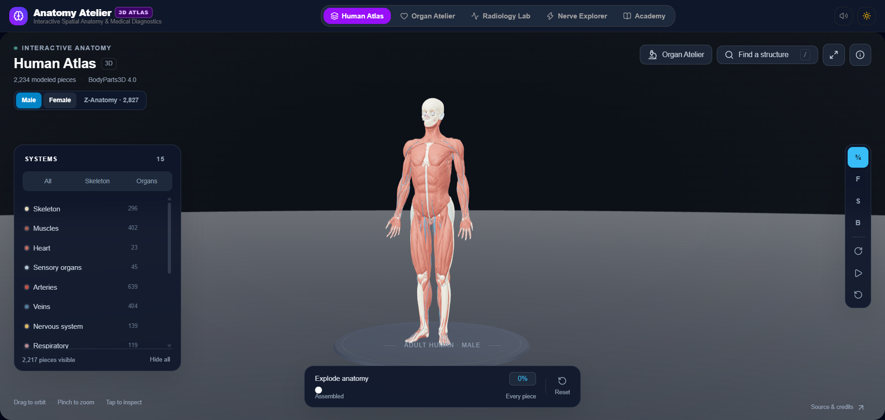
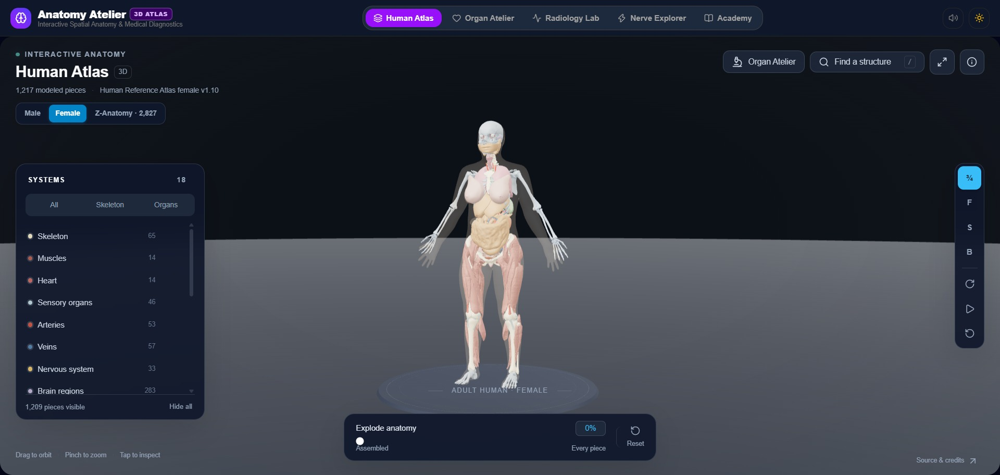
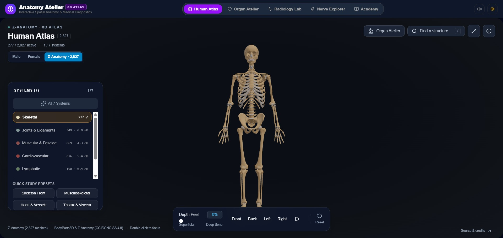
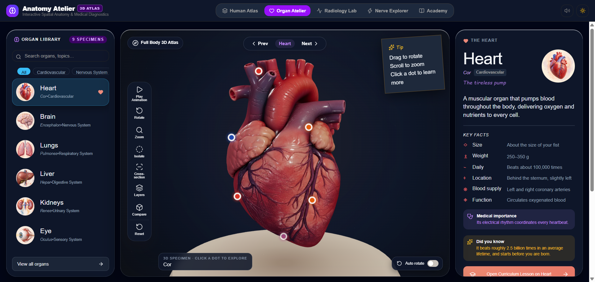
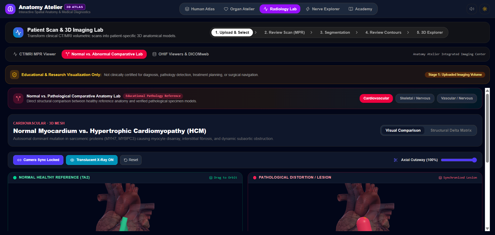
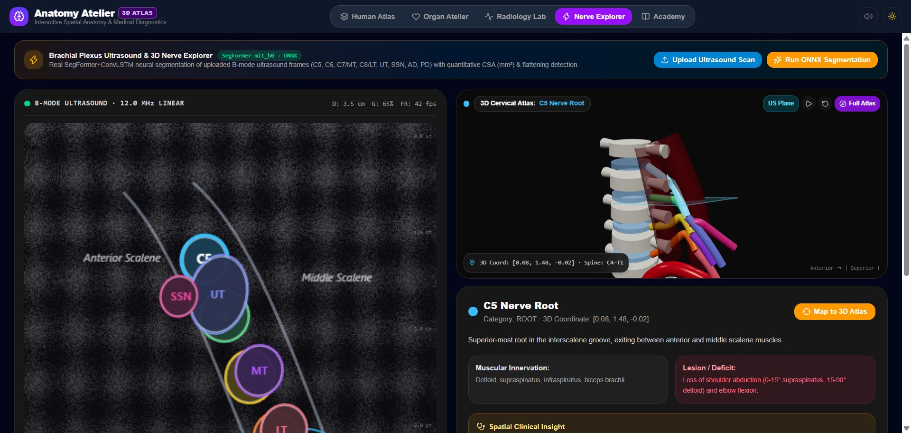

# Anatomy Atelier — Interactive 3D Human Anatomy, Spatial Learning & Radiology Lab

> **Author & Maintainer:** Nikshith Nayak  
> **Live Demo (Vercel):** [human-anatomy-eight.vercel.app](https://human-anatomy-eight.vercel.app)  
> **Repository:** [github.com/Nikshithnayak/Human-Anatomy](https://github.com/Nikshithnayak/Human-Anatomy)

**Anatomy Atelier** is a spatial computing and 3D medical education platform built with **Next.js 16 (App Router / `vinext`), React 19, TypeScript, Three.js WebGL2, and ONNX Runtime Web**. It brings together interactive full-body 3D anatomy, detailed 9-organ dissection, client-side DICOM MPR & OHIF tools, side-by-side normal-vs-pathological 3D comparison, real SegFormer+ConvLSTM brachial plexus ultrasound segmentation, and board-style clinical learning in one edge-ready web application.

---

## Visual Showcase

| Full-Body Human Atlas (Male) | Adult Female Reference Anatomy |
|---|---|
|  |  |

| Z-Anatomy 2,827 Structures Atlas | Organ Atelier (3D Dissection & Histology) |
|---|---|
|  |  |

| Normal vs. Abnormal 3D Comparative Lab | Peripheral Nerve Explorer (ONNX Ultrasound) |
|---|---|
|  |  |

---

## Platform Workspace Overview

| Module | Core Capabilities |
|---|---|
| **Human Atlas** | Three switchable full-body atlases (`Male` 2,234 meshes, `Female` 1,217 meshes, `Z-Anatomy` 2,827 meshes across 7 Draco GLB systems), gzip chunk streaming, `three-mesh-bvh` picking, radial explosion / depth peel sliders, live 3D camera tour, search, and TA2 Latin relationships. |
| **Organ Atelier** | High-detail GLB dissection viewer across 9 organs (`Heart`, `Brain`, `Lungs`, `Liver`, `Kidneys`, `Eyeball`, `Intestine`, `Pancreas`, `Skin`) with live physiological motion, cross-section slicing, layer controls, anatomy quizzes, and histology/clinical inspection cards. |
| **Radiology Lab** | Client-side DICOM Part 10 parser & HIPAA metadata scrubber, 2×2 Quad MPR (Axial/Coronal/Sagittal), calibrated calipers/angle/ROI & HU probe tools (`dicom-parser` + `dcmjs` TID-1500 SR export), 3D surface mesh generation, and Synchronized Dual-Viewport Normal vs. Abnormal 3D Pathology Lab (Heart HCM, L4–L5 Disc Herniation, Circle of Willis Aneurysm). |
| **Nerve Explorer** | Brachial plexus B-mode ultrasound studio backed by a real exported `SegFormer (mit_b0) + ConvLSTM` ONNX model (`18.52 MB`) running locally via `onnxruntime-web` WASM or Python CLI (`services/nerve_explorer/run_inference.py`), computing calibrated CSA ($\text{mm}^2$) and nerve flattening ratios alongside a synchronized 3D C4–T1 cervical spine & plexus view. |
| **Academy** | Structured clinical lessons (`Cardiac Conduction`, `Circle of Willis`, etc.), USMLE/NEET-PG style board spotters, and persistent study notes & bookmarks. |

---

## Technology Stack

- **Framework & Compiler:** Next.js 16 App Router, React 19, TypeScript, `vinext` (Vite 8 + Cloudflare Workers)
- **3D & Spatial Graphics:** Three.js v0.185.1, `three-mesh-bvh`, Meshopt + Draco decoders, GSAP
- **Medical Imaging & ML:** `dicom-parser`, `dcmjs`, `onnxruntime-web` (`public/models/brachial-plexus.onnx`)
- **UI & Styling:** Tailwind CSS 4, Lucide Icons, Web Audio feedback
- **Validation & Testing:** ESLint (`--max-warnings=0`), `tsc --noEmit`, `vinext build`, Node.js test runner (`node --test`, 22 tests)

---

## Getting Started

### Prerequisites
- Node.js `>= 22.13.0`
- WebGL 2.0 compatible browser

### Clone & Install
```bash
git clone --recurse-submodules https://github.com/Nikshithnayak/Human-Anatomy.git
cd Human-Anatomy
npm install
```

### Run Development Server
```bash
npm run dev
```
Open `http://localhost:3000/en` in your browser.

### Typecheck, Production Build & Automated Tests
```bash
npm run test:build
```

### Run Local Python Nerve Segmentation CLI (Optional)
```bash
python services/nerve_explorer/run_inference.py --image <path-to-ultrasound-png>
```

---

## License & Dataset Attribution

- **Application Code (`Nikshith Nayak`)**: Original application source code, UI components, and integrations are **Copyright © 2026 Nikshith Nayak**, licensed under the [MIT License](LICENSE).
- **Third-Party Anatomical Datasets, Submodules & Pretrained Weights** (retained under their required open-source and Creative Commons licenses):
  - **BodyParts3D 4.0**: © The Database Center for Life Science (DBCLS) — [CC BY 4.0](https://creativecommons.org/licenses/by/4.0/) / CC BY-SA 2.1 Japan
  - **Human Reference Atlas Female v1.10**: © HuBMAP Consortium & U.S. NLM — [CC BY 4.0](https://creativecommons.org/licenses/by/4.0/)
  - **Z-Anatomy (`nqwrc/3d-anatomy`)**: CC BY-NC-SA 4.0 (`public/z-anatomy/LICENSE.txt`, `public/z-anatomy/NOTICE.txt`)
  - **OHIF Viewers (`OHIF/Viewers`, `dicom-parser`, `dcmjs`)**: MIT License
  - **Hierarchical-Temporal-BP-Seg (`brachial-plexus.onnx`)**: MIT License
- See [docs/THIRD_PARTY_LICENSES.md](docs/THIRD_PARTY_LICENSES.md) and [docs/datasets/DATASET_ATTRIBUTION.md](docs/datasets/DATASET_ATTRIBUTION.md) for complete notices.
