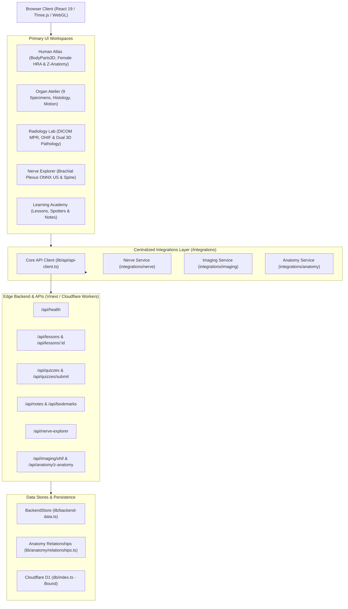

# Anatomy Atelier — System Architecture Specification

## 1. Executive Summary & Architectural Vision

**Anatomy Atelier** is an enterprise-grade spatial computing and 3D medical education platform designed for medical students, radiology residents, surgeons, and healthcare professionals. Built on modern web standards (Next.js 16 App Router, React 19, Three.js WebGL/WebGL2, and TypeScript), it bridges the gap between abstract 2D medical textbooks and real-world 3D clinical pathology.

The architecture emphasizes:
1. **Zero-Latency Spatial Exploration**: Client-side GPU-accelerated rendering of human systems, organs, and multiplanar medical imaging.
2. **Strict Medical Safety & Disclaimers**: Explicit separation between educational visualization and clinical diagnostic tools.
3. **Decoupled Centralized Integration Layer**: Unified type-safe API client with abort controllers, timeout handling, and typed error normalization.
4. **Focused Educational Scope**: Clean, zero-bloat platform dedicated exclusively to 3D Anatomy, Organ Dissection, Radiology, and Clinical Education.

---

## 2. High-Level Architecture Topology

---

## 3. Core Subsystems

### 3.1 3D Spatial Atlas & Scene Graph Subsystem
- **Engine**: Three.js v0.185.1 running on WebGL / WebGL2 context.
- **Model Formats**: Multi-mesh binary GLTF/GLB models located in `public/models/` and chunked binary geometry.
- **Scene Hierarchy**:
  - `Root Scene` -> `Lighting Rig` (Ambient + Directional Hemispherical Key/Fill lights).
  - `Anatomical Groups`: Categorized into 6 core anatomical systems:
    - Skeletal (`skel`)
    - Muscular (`musc`)
    - Cardiovascular (`card`)
    - Nervous (`nerv`)
    - Visceral Organs (`visc`)
    - Integumentary (`integ`)
- **Raycasting & Interaction**: Pointer-tap detection calculates intersection points against mesh bounding boxes, highlighting target nodes via emissive uniforms and opening the Structure Inspector Sheet.
- **Explosion Layout**: Coordinate transforms displace organ meshes along anatomically realistic radial trajectories for unoccluded interior inspection.

### 3.2 Radiology Lab & Multiplanar Reconstruction (MPR)
- **DICOM Parser**: Client-side Part 10 parser reading 128-byte preamble, `DICM` magic bytes, patient metadata, and image pixel data.
- **Multiplanar Reconstruction (MPR)**:
  - Generates cross-sectional slices across Axial (Transverse), Sagittal, and Coronal planes from physical volume coordinate matrices.
  - Implements interactive Hounsfield Unit (HU) windowing:
    - Soft Tissue (W: 400, L: 40)
    - Bone (W: 1800, L: 400)
    - Lung (W: 1500, L: -600)
    - Brain (W: 80, L: 40)
- **3D Surface Reconstruction**: Custom isocontour extraction and surface meshing rendering real-time Three.js `BufferGeometry` with vertex normal recalculation.
- **Normal vs. Abnormal Comparative Lab**: Side-by-side synchronized viewports comparing normal anatomical structures against pathognomonic cases (e.g. Asymmetric Septal Hypertrophy in HCM, Lumbar Disc Extrusion with Nerve Root Impingement, Anterior Communicating Artery Saccular Aneurysm).

### 3.3 Brachial Plexus Ultrasound & ONNX Segmentation Subsystem
- **Brachial Plexus Ultrasound Lab (`NerveExplorer`)**:
  - Browser ONNX inference (`lib/imaging/nerve-onnx-runtime.ts`) running `public/models/brachial-plexus.onnx` (18.52 MB exported from `external/brachial-plexus/lightning_logs/seq50/checkpoints/last.ckpt`) alongside local Python inference (`services/nerve_explorer/run_inference.py`).
  - 8 segmented classes (`C5`, `C6`, `C7/MT`, `C8/LT`, `UT`, `SSN`, `AD`, `PD`) with depth-calibrated Cross-Sectional Area ($\text{mm}^2$) and major/minor axis flattening alerts.
  - Synchronized 3D C4–T1 cervical spine & brachial plexus Three.js view.

### 3.4 Centralized Integration Layer (`/integrations`)
Components invoke typed REST helpers through `lib/api/api-client.ts`:
- `lib/api/api-client.ts`: Shared HTTP client wrapping `fetch` with `AbortSignal.timeout`, status validation, and `ApiClientError` normalization.
- `integrations/nerve/`: Peripheral nerve endpoint helpers.
- `integrations/imaging/`: Volumetric MPR, OHIF bridge, and segmentation ontology helpers.
- `integrations/anatomy/`: Relationships, systems, and 3D organ metadata helpers.

### 3.5 Learning Academy & USMLE Spotter Quizzes
- **Curriculum Modules**: Multi-stage lessons covering cardiac conduction, Circle of Willis cerebral hemodynamics, and brachial plexus topography with knowledge checkpoints.
- **Spotter Quizzes**: Clinical vignette-driven question banks with randomized distractor analysis, board exam pearls, and persistent high score tracking.
- **Personalized Notes & Bookmarks**: Full CRUD note-taking with structure tagging and bookmarking.

---

## 4. Edge Runtime & Deployment Configuration

- **Hosting & Bundling**: Packaged with `vinext` (Vite-powered Next.js App Router compiler) for edge execution on Cloudflare Workers.
- **Cold Start Optimization**: Static assets, 3D binary meshes, and dictionary files served directly via Cloudflare Pages CDN edge cache.
- **Dual Node / Worker Compatibility**: Unit and integration tests run in Node.js test runner (`node --test`) using the compiled production server entry point (`dist/server/index.js`).

